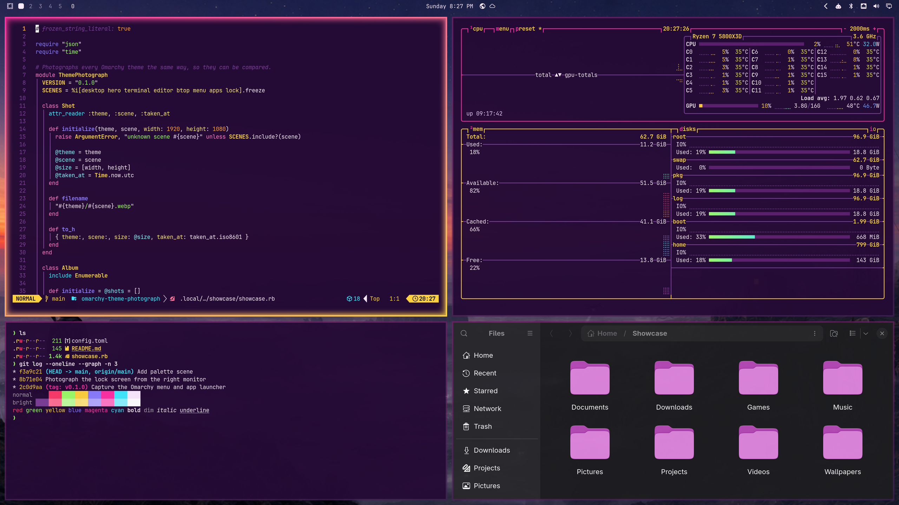

# Ringside Royalty

A glam, glitter-and-gold Omarchy theme: hot pink, sequin purple and spotlight gold, straight from the entrance ramp.



## Install

```bash
omarchy theme install https://github.com/Gleasonmt/omarchy-ringside-royalty-theme
```

Then pick **Ringside Royalty** from the theme menu, or run `omarchy theme set ringside-royalty`.

## What's included

- Colors for the shell, terminals, Neovim, btop and the rest of Omarchy (`colors.toml`, `shell.toml`, `btop.theme`)
- Four original wallpapers in `backgrounds/`
- Chromium toolbar color and a matching icon theme
- A boot unlock logo (`unlock.png`); choose it with `omarchy plymouth switcher`
- An RGB keyboard color (`keyboard.rgb`) for supported ASUS ROG and Framework 16 keyboards
- An optional Firefox theme in `firefox/`. Load it from `about:debugging` → This Firefox → Load Temporary Add-on → `firefox/manifest.json`

## Credits

The wallpapers and unlock logo were created by the author for this theme and are
released under the same license as the rest of the theme.

## License

[MIT](LICENSE)
